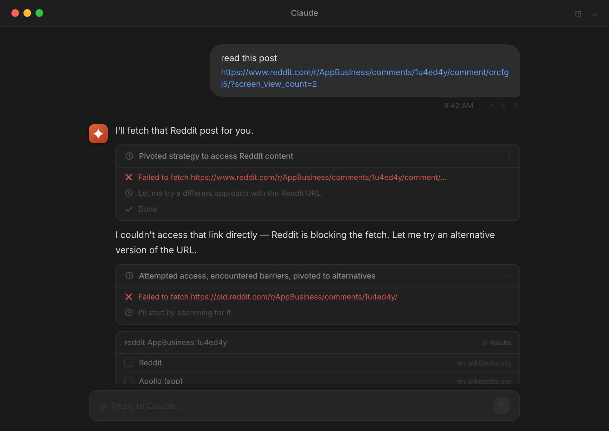
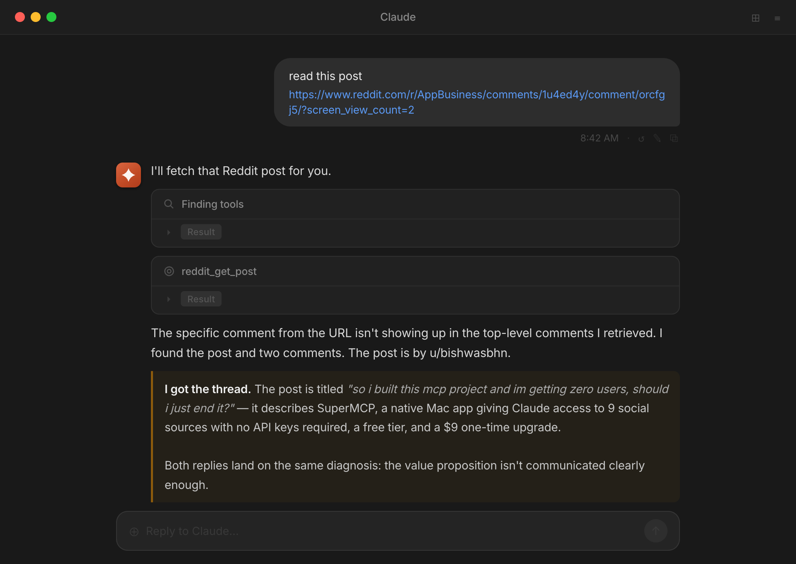
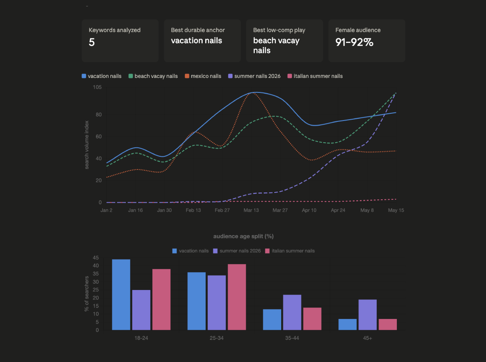

# MCP Browser

Claude, Cursor and other MCP clients cannot open Reddit, X, LinkedIn or Facebook. Those sites block AI fetchers, so you end up reading the threads yourself and pasting them in. MCP Browser is a Mac app that lets your AI read those sites through your own Chrome login, so it sees exactly what you see and answers with links. It also reads your Search Console, Google Analytics and Microsoft Clarity data. No API keys, no OAuth setup.

Website: [webmatrices.com/mcpbrowser](https://webmatrices.com/mcpbrowser)

| Before | After |
|---|---|
|  |  |

## Install

Mac with Apple Silicon. Download, open, sign in, press Connect.

1. Download the app from the [latest release](https://github.com/Bishwas-py/mcpbrowser/releases/latest) or from [webmatrices.com/mcpbrowser](https://webmatrices.com/mcpbrowser). Drag it into Applications and open it. The app is signed and notarized.
2. Sign in with a free Webmatrices account.
3. Press **Connect** next to your AI client. The app detects what you have installed and writes the MCP config for it. No JSON to edit.

Supported clients: Claude Desktop, Claude Code, Cursor, Windsurf, Zed, VS Code.

Other ways in:

```bash
brew install --cask bishwas-py/tap/mcpbrowser
```

Claude Desktop only: download the `.mcpb` file from the [latest release](https://github.com/Bishwas-py/mcpbrowser/releases/latest) and double-click it. No app needed.

## What it reads

| Source | What you can ask for | Runs through |
|---|---|---|
| [Reddit](https://webmatrices.com/mcpbrowser/reddit-mcp) | Search, subreddit feeds, a post with its comment tree, a user's history | Direct |
| [X / Twitter](https://webmatrices.com/mcpbrowser/twitter-mcp) | Search tweets, a tweet with replies, a user's timeline | Your Chrome login |
| [LinkedIn](https://webmatrices.com/mcpbrowser/linkedin-mcp) | Search posts, your home feed, comments on a post, your creator analytics | Your Chrome login |
| [Facebook](https://webmatrices.com/mcpbrowser/facebook-mcp) | Search public posts, a page's recent posts, your page insights | Your Chrome login |
| [Pinterest](https://webmatrices.com/mcpbrowser/pinterest-mcp) | Search pins, boards, a user's pins, trends with demographics, pin images for vision | Your Chrome login |
| [Medium](https://webmatrices.com/mcpbrowser/medium-mcp) | Search articles, tag feeds, a writer's latest | Login for search, feeds are direct |
| [Dev.to](https://webmatrices.com/mcpbrowser/dev-to-mcp) | Search, trending, an article with comments, a user's articles | Direct |
| [BlackHatWorld](https://webmatrices.com/mcpbrowser/blackhatworld-mcp) | Search, a thread with replies, latest posts | Your Chrome login |
| Google News and Trends | Trending terms by region, news search, top stories, by topic | Direct |
| [Google Search Console](https://webmatrices.com/mcpbrowser/google-search-console-mcp) | Clicks, impressions, CTR and position by query, page, country, device or date | Your Google login |
| [Google Analytics and Clarity](https://webmatrices.com/mcpbrowser/google-analytics-mcp) | GA4 pages, traffic, users, events. Clarity sessions, dead clicks, scroll depth | Your Google and Microsoft logins |

Ask the way you would ask a person. "What do people on r/webdev hate about Vercel pricing this month" is a fine prompt. The AI picks the tools.



<details>
<summary>Full tool list</summary>

| Tool | Description |
|---|---|
| `reddit_search` | Search all of Reddit |
| `reddit_search_subreddit` | Search within a specific subreddit |
| `reddit_get_post` | Get a post with its top comments |
| `reddit_get_subreddit_posts` | List posts (hot, top, new, rising) |
| `reddit_get_user_activity` | A user's recent posts and comments |
| `twitter_search` | Search tweets |
| `twitter_get_tweet` | A tweet with its replies |
| `twitter_get_user_tweets` | A user's recent tweets |
| `linkedin_search` | Search posts by keyword |
| `linkedin_feed` | Posts from your home feed |
| `linkedin_post_comments` | Comments on a specific post |
| `linkedin_analytics` | Your creator analytics, content or audience view |
| `facebook_search` | Search public posts by keyword |
| `facebook_get_posts` | Recent posts from a page or profile with reaction, comment and share counts |
| `facebook_insights` | Meta Business Suite page insights |
| `pinterest_search` | Search pins by keyword |
| `pinterest_get_pin` | A pin with title, image, source and top comments |
| `pinterest_get_user_pins` | A user's recent pins |
| `pinterest_get_user_boards` | A user's board list |
| `pinterest_get_board` | Pins inside a board |
| `pinterest_trends` | Trending Pinterest searches |
| `pinterest_trends_related` | Related trending terms |
| `pinterest_trends_demographics` | Age and gender split for a term |
| `pinterest_download_pin_image` | Download a pin image for vision analysis |
| `medium_search` | Search articles |
| `medium_tag_feed` | Latest articles by tag |
| `medium_user_feed` | A writer's latest articles |
| `devto_search` | Search articles |
| `devto_trending` | Trending articles, overall or by tag |
| `devto_article` | An article with nested comments |
| `devto_user_articles` | A user's published articles |
| `bhw_search` | Search BlackHatWorld posts |
| `bhw_get_thread` | A thread with the opening post and replies |
| `bhw_latest` | Latest posts site-wide |
| `trends_get_trending` | Trending search terms by region |
| `news_search` | Search Google News by keyword |
| `news_top` | Top news stories |
| `news_by_topic` | News by category |
| `search_console_report` | Search Console performance by query, page, country, device or date |
| `ga4_report` | GA4 pages, traffic, users or events for a property |
| `clarity_dashboard` | Clarity dashboard for a project |
| `browse_anything` | Open a URL through your Chrome session and read it |
| `mcpbrowser_status` | Which sources are reachable and signed in |

</details>

## How it works

Every AI client spawns its own private worker process and talks to it over stdio. Public sources are fetched directly. Logged-in sources run through a second headless Chrome that starts from a copy of your own Chrome profile, so it inherits every site you are signed in to. Your main Chrome keeps running and nothing is exported from it.

The app shows a live activity log across clients, so you can see that Cursor is reading Pinterest while Claude Desktop is reading Reddit.

## The three questions everyone asks

**Will Reddit or LinkedIn ban my account?** They would have to ban your own browser. The requests come from your Mac, your cookies, your normal IP and a real Chromium fingerprint. MCP Browser never posts, follows, likes or sends messages. It reads.

**Where do my logins go?** Nowhere. Cookies stay inside your own Chrome and are never sent to us. When a tool runs, a private record of that call (which tool, what it asked, the text it returned) is saved to your Webmatrices account so you can review it. Secrets your AI passes into a tool are blanked out first, and images are never uploaded.

**Do I need to be technical?** No. Download, sign in, press Connect. Most people run their first query within a few minutes.

## Pricing

| | Free | Unlimited |
|---|---|---|
| Price | $0 | $9.99 once |
| Requests | 50 a day | Unlimited |
| Sources and tools | All | All |
| Renewal | None | None |

## About this repository

MCP Browser is closed source. The worker and the desktop app are not here. This repository holds the install notes, the release downloads and the manifest for the [MCP Registry](https://registry.modelcontextprotocol.io). Use [Issues](https://github.com/Bishwas-py/mcpbrowser/issues) for bug reports, especially when a site changes its layout and a tool stops working. Updates ship through the app.

Terms: [webmatrices.com/terms-conditions](https://webmatrices.com/terms-conditions). Privacy: [webmatrices.com/privacy-policy](https://webmatrices.com/privacy-policy).
